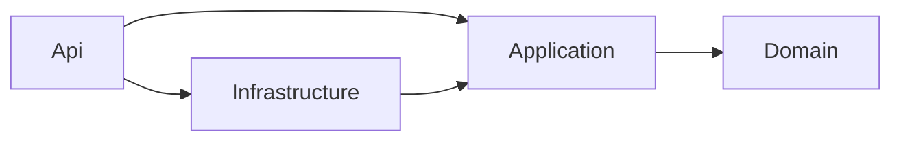
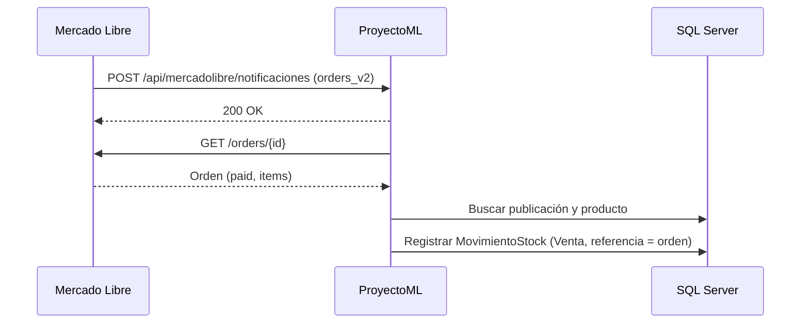
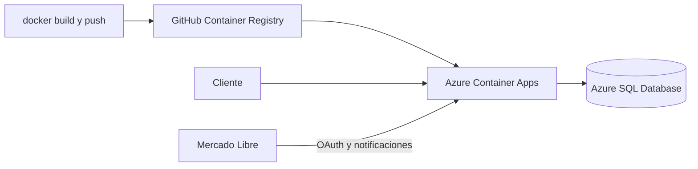

# ProyectoML

API REST para manejar los productos y el inventario de un vendedor de Mercado Libre. Permite tener el catálogo con su stock, publicar productos en Mercado Libre y descontar el stock solo cuando entra una venta.

## Funcionalidades

- [x] Registro y login con JWT, cada usuario ve solo sus datos
- [x] Categorías y productos con imágenes
- [x] Stock con historial de movimientos (ingresos, ventas y ajustes)
- [x] Vincular cuentas de Mercado Libre por OAuth 2.0 (se puede tener más de una)
- [x] Publicar productos en Mercado Libre y sincronizar el estado de la publicación
- [x] Webhook de órdenes: cuando una venta se paga, se descuenta el stock
- [x] Cambios de precio y stock que se envían a Mercado Libre
- [x] Errores con ProblemDetails
- [x] Tests unitarios de las reglas de negocio

## Stack

- .NET 10 / ASP.NET Core Web API
- Entity Framework Core 10 (Code First con migraciones)
- SQL Server
- JWT Bearer
- API de Mercado Libre (OAuth, items, órdenes y notificaciones)
- xUnit
- Docker y Azure (Container Apps y Azure SQL Database)

## Arquitectura

Usé Clean Architecture. El dominio no depende de nada y el resto de las capas apuntan hacia adentro.



| Capa | Qué tiene |
|---|---|
| **Domain** | Entidades con sus reglas y validaciones. No depende de nada. |
| **Application** | Services (casos de uso), DTOs e interfaces de repositorios y servicios externos. |
| **Infrastructure** | EF Core (DbContext, configuraciones y repositorios), el cliente HTTP de Mercado Libre, JWT y hash de contraseñas. |
| **Api** | Controllers, autenticación, manejo de errores y la inyección de dependencias. |

### Cómo funciona una venta



## Decisiones de diseño

**El stock solo cambia con movimientos.**
No hay un setter para el stock. Todo pasa por `Producto.RegistrarMovimiento()`, que valida y crea un `MovimientoStock`, así siempre se puede ver de dónde salió cada cambio.

**El webhook no descuenta dos veces.**
Mercado Libre puede mandar la misma notificación más de una vez, y a veces llegan casi al mismo tiempo. Cada venta se guarda con el id de la orden como referencia y antes de descontar reviso si ya existe. Igual me pasó en las pruebas que dos notificaciones llegaron con 30 ms de diferencia y se duplicó el movimiento, así que agregué un índice único filtrado `(ProductoId, Referencia)` en la base para que eso no pueda pasar.

**Las entidades se validan solas.**
Las propiedades son `private set` y las validaciones están en los constructores y en los métodos de negocio, para que no se pueda dejar una entidad en un estado inválido.

**Todo pide token por defecto.**
Hay una `FallbackPolicy` que exige usuario autenticado en todos los endpoints. Los únicos públicos son registro, login, el callback de OAuth y el webhook. El usuario se saca siempre del token y no del request.

**Cada usuario ve solo lo suyo.**
Categorías, productos, cuentas y publicaciones son de un usuario. Si alguien pide algo de otro usuario le devuelvo 404, igual que si no existiera, para no dar pistas de qué hay.

**Entidades y DTOs separados.**
Los repositorios trabajan con entidades, los services las pasan a DTOs y los controllers nunca devuelven entidades.

**Errores de negocio a códigos HTTP.**
Tengo excepciones propias (`DomainException` 400, `AuthException` 401, `NotFoundException` 404, `ConflictException` 409) y un `IExceptionHandler` global que las convierte en ProblemDetails. Si Mercado Libre rechaza algo se responde 400 o 502. Así los controllers no necesitan `try/catch`.

**Integraciones detrás de interfaces.**
Los repositorios y los servicios externos son interfaces en Application y se implementan en Infrastructure, entonces la lógica se puede testear sin base de datos ni Mercado Libre.

## Cómo ejecutarlo

Necesitas .NET 10 SDK, SQL Server LocalDB (viene con Visual Studio) y una aplicación creada en el [DevCenter de Mercado Libre](https://developers.mercadolibre.cl/devcenter).

```bash
git clone https://github.com/Manutapiaz/ProyectoML.git
cd ProyectoML

dotnet user-secrets set "Jwt:Key" "<clave aleatoria de al menos 32 caracteres>" --project ProyectoML.Api
dotnet user-secrets set "MercadoLibre:ClientId" "<client id>" --project ProyectoML.Api
dotnet user-secrets set "MercadoLibre:ClientSecret" "<client secret>" --project ProyectoML.Api

dotnet tool install --global dotnet-ef
dotnet ef database update --context AppDbContext --project ProyectoML.Infrastructure --startup-project ProyectoML.Api
dotnet ef database update --context ClavesDbContext --project ProyectoML.Infrastructure --startup-project ProyectoML.Api
dotnet run --project ProyectoML.Api
```

Para el callback de OAuth y las notificaciones Mercado Libre tiene que poder llegar a la API desde internet. Yo usé Dev Tunnels (ngrok también sirve). Con la URL pública hay que configurar:

- `MercadoLibre:RedirectUri` en appsettings o user-secrets, y la misma Redirect URI en el DevCenter.
- La URL de notificaciones en el DevCenter: `https://<url-publica>/api/mercadolibre/notificaciones`, con el tópico **Orders v2**.

En `ProyectoML.Api/ProyectoML.Api.http` está todo el recorrido para probar: registro, login, vincular cuenta, crear categoría, producto y publicarlo.

## Endpoints

Todos piden `Authorization: Bearer <token>` menos los que dicen público.

**Autenticación**

| Método | Ruta | Descripción |
|---|---|---|
| POST | `/api/auth/register` | Registrar usuario (público) |
| POST | `/api/auth/login` | Login, devuelve el JWT (público) |

**Categorías**

| Método | Ruta | Descripción |
|---|---|---|
| GET | `/api/categorias` | Categorías del usuario |
| GET | `/api/categorias/{id}` | Una categoría |
| POST | `/api/categorias` | Crear categoría |
| PUT | `/api/categorias/{id}/categoria-ml` | Asociarla a una categoría de Mercado Libre |

**Productos**

| Método | Ruta | Descripción |
|---|---|---|
| GET | `/api/productos` | Productos del usuario |
| GET | `/api/productos/{id}` | Un producto |
| POST | `/api/productos` | Crear producto, con stock inicial e imágenes (opcionales) |
| GET | `/api/productos/{id}/imagenes` | Imágenes del producto |
| POST | `/api/productos/{id}/imagenes` | Agregar imagen |
| DELETE | `/api/productos/{id}/imagenes/{imagenId}` | Borrar imagen |
| POST | `/api/productos/{id}/publicaciones` | Publicar en Mercado Libre |
| PATCH | `/api/productos/{id}/precios` | Cambiar precio (también en Mercado Libre) |
| POST | `/api/productos/{id}/movimientos` | Ajustar stock, sumando o restando (también en Mercado Libre) |

**Mercado Libre**

| Método | Ruta | Descripción |
|---|---|---|
| GET | `/api/mercadolibre/login` | URL para vincular una cuenta |
| GET | `/api/mercadolibre/callback` | Callback de OAuth (público) |
| GET | `/api/mercadolibre/cuenta/{userId}` | Datos de una cuenta vinculada |
| GET | `/api/mercadolibre/sugerencias?nombreProducto=` | Categorías sugeridas para un producto |
| GET | `/api/mercadolibre/categorias/{categoryId}/atributos?userId=` | Atributos de una categoría |
| POST | `/api/mercadolibre/notificaciones` | Webhook (público) |

**Publicaciones**

| Método | Ruta | Descripción |
|---|---|---|
| GET | `/api/publicaciones?userId=` | Publicaciones de una cuenta |
| GET | `/api/publicaciones/{externalId}` | Una publicación |
| POST | `/api/publicaciones/{externalId}/sincronizar` | Traer el estado actual desde Mercado Libre |

## Tests

```bash
dotnet test
```

Prueban las reglas de `Producto`: validaciones del constructor, cambio de precio, imágenes (máximo, URL válida y duplicadas) y movimientos de stock, incluyendo los casos inválidos para revisar que la entidad no quede a medias.

## Docker

Si no quieres instalar .NET ni LocalDB, puedes levantar la API y SQL Server con Docker.

Necesitas Docker Desktop y, si vas a vincular cuentas de Mercado Libre, una URL pública (por ejemplo Dev Tunnels).

Crea un `.env` en la raíz (ya está en el `.gitignore`):

```env
SA_PASSWORD=<al menos 8 caracteres con mayúsculas, minúsculas y números>
JWT_KEY=<clave aleatoria de al menos 32 caracteres>
ML_CLIENT_ID=<client id>
ML_CLIENT_SECRET=<client secret>
DEV_TUNNEL=https://<url-publica>/api/mercadolibre/callback
```

```bash
docker compose up --build
```

La API queda en `http://localhost:5000` y las migraciones corren al arrancar. La base y las claves de Data Protection (con esas se cifran los tokens de Mercado Libre) quedan en volúmenes, así que no se pierden si recreas los contenedores.

El túnel tiene que apuntar al puerto 5000:

```bash
devtunnel host -p 5000 --allow-anonymous
```

Con esa URL completas `DEV_TUNNEL` y en el DevCenter la Redirect URI (`https://<url-publica>/api/mercadolibre/callback`) y la de notificaciones (`https://<url-publica>/api/mercadolibre/notificaciones`). Si cambias el `.env`, con `docker compose up -d` se recrea la API con los valores nuevos.

Para entrar a la base desde SSMS: servidor `localhost,1433`, usuario `sa`, la clave de `SA_PASSWORD` y marcar *Trust server certificate*.

## Despliegue en Azure

La API está corriendo en Azure con servicios que tienen capa gratuita:

https://ca-proyectoml-api.wonderfuldune-c4d91165.brazilsouth.azurecontainerapps.io

Ojo que el Container App escala a cero y la base se pausa cuando no se usa, así que la primera petición después de un rato puede demorar.



| Recurso | Para qué |
|---|---|
| **Azure Container Apps** (consumo) | Corre la imagen de la API con HTTPS y una URL fija, que es la que uso en Mercado Libre para el callback y las notificaciones. Escala a cero si no hay tráfico. |
| **Azure SQL Database** (oferta gratuita, serverless) | Los datos de la app y las claves de Data Protection. Se pausa sola. |
| **GitHub Container Registry** | La imagen pública `ghcr.io/manutapiaz/proyectoml`, con el hash corto del commit como tag. |

### Decisiones

**Las claves de Data Protection van en la base.**
El disco del contenedor se borra cada vez que se reinicia, se despliega o escala a cero. Si las claves quedaban ahí, los tokens cifrados de Mercado Libre no se podían leer y había que volver a vincular las cuentas. Por eso las guardo con `PersistKeysToDbContext` en un `ClavesDbContext` aparte. No usé `AppDbContext` porque ese ya depende de Data Protection para cifrar los tokens y se armaba una dependencia circular. En Docker siguen en el volumen (`DataProtection:RutaClaves`).

**Reintentos.**
La base serverless se demora cerca de un minuto en despertar después de pausarse. Los dos contextos tienen `EnableRetryOnFailure` (6 reintentos), así que la primera petición tarda pero no falla.

**Secretos fuera de la imagen.**
La imagen es pública y no lleva nada sensible. La cadena de conexión, `Jwt:Key` y el client secret de Mercado Libre están como secretos en Container Apps y le llegan a la API como variables de entorno.

### Configuración del Container App

Puerto `8080` y estas variables:

| Variable | Valor |
|---|---|
| `ConnectionStrings__ProyectoMlCONN` | Secreto, cadena de conexión de Azure SQL |
| `Jwt__Key` | Secreto, clave aleatoria de al menos 32 caracteres |
| `MercadoLibre__ClientId` | Client id de la app de Mercado Libre |
| `MercadoLibre__ClientSecret` | Secreto, client secret de la app de Mercado Libre |
| `MercadoLibre__RedirectUri` | `https://<url-de-la-app>/api/mercadolibre/callback` |

`DataProtection__RutaClaves` se deja sin definir para que las claves vayan a la base. En el DevCenter van la misma Redirect URI y la URL de notificaciones `https://<url-de-la-app>/api/mercadolibre/notificaciones`.

### Migraciones

Las aplico desde mi PC antes de desplegar (la IP tiene que estar permitida en el firewall del servidor SQL):

```bash
dotnet ef database update --context AppDbContext --connection "<cadena de conexión>" --project ProyectoML.Infrastructure --startup-project ProyectoML.Api
dotnet ef database update --context ClavesDbContext --connection "<cadena de conexión>" --project ProyectoML.Infrastructure --startup-project ProyectoML.Api
```

### Publicar una versión nueva

```bash
TAG=$(git rev-parse --short HEAD)
docker build --provenance=false --sbom=false -t ghcr.io/manutapiaz/proyectoml:$TAG -t ghcr.io/manutapiaz/proyectoml:latest .
docker push ghcr.io/manutapiaz/proyectoml --all-tags
```

Después en el Container App: **Contenedores → Editar e implementar** y elegir el tag nuevo. Se crea otra revisión y el tráfico se pasa a esa cuando termina de arrancar.
