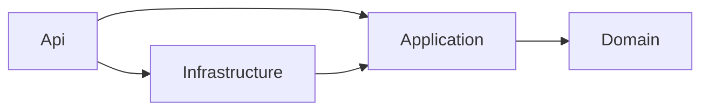
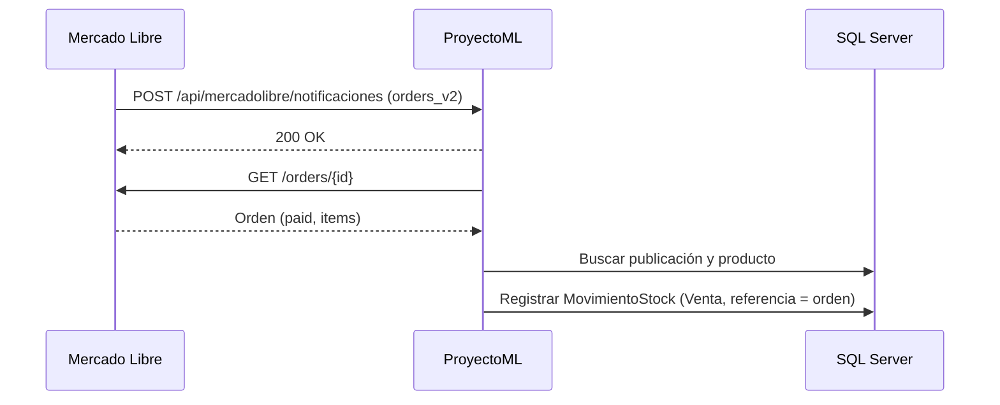

# ProyectoML

API REST para gestionar productos e inventario de un vendedor de Mercado Libre: catálogo con stock trazable, publicación de productos y sincronización automática de stock a partir de las ventas.

## Funcionalidades

- [x] Registro e inicio de sesión con JWT; cada usuario ve solo sus propios datos
- [x] Categorías y productos, con imágenes
- [x] Stock trazable por movimientos (ingresos, ventas, ajustes)
- [x] Vinculación de cuentas de Mercado Libre por OAuth 2.0 (un usuario puede tener varias)
- [x] Publicación de productos en Mercado Libre y sincronización de su estado
- [x] Webhook de órdenes: cada venta pagada descuenta stock automáticamente
- [x] Manejo de errores estandarizado (ProblemDetails)
- [x] Tests unitarios de reglas de negocio

## Stack

- .NET 10 / ASP.NET Core Web API
- Entity Framework Core 10 (Code First + migraciones)
- SQL Server
- Autenticación JWT Bearer
- API de Mercado Libre (OAuth 2.0, items, órdenes, notificaciones)
- xUnit

## Arquitectura

Clean Architecture: el dominio no depende de ninguna capa externa, y las dependencias apuntan hacia adentro.



| Capa | Responsabilidad |
|---|---|
| **Domain** | Entidades con sus reglas de negocio y validaciones. Sin dependencias. |
| **Application** | Casos de uso (services), DTOs e interfaces de repositorios y servicios externos. |
| **Infrastructure** | EF Core (DbContext, configuraciones, repositorios), cliente HTTP de Mercado Libre, JWT y hashing de contraseñas. |
| **Api** | Controllers, autenticación, manejo global de errores y configuración de inyección de dependencias. |

### Flujo de una venta



## Decisiones de diseño

**El stock solo cambia a través de movimientos.**
No existe un setter de stock: todo cambio pasa por `Producto.RegistrarMovimiento()`, que valida la operación y registra un `MovimientoStock`. Así el stock siempre se puede auditar y reconstruir desde su historial.

**Webhook idempotente.**
Mercado Libre puede enviar la misma notificación varias veces, incluso en paralelo. Cada venta queda registrada con el id de la orden como referencia; antes de descontar stock se verifica si ya existe, y un índice único filtrado `(ProductoId, Referencia)` en la base de datos cierra la carrera entre notificaciones simultáneas. Una orden nunca descuenta stock dos veces.

**Entidades que se protegen a sí mismas.**
Las propiedades tienen `private set` y las validaciones están en los constructores y métodos de negocio. No se puede crear ni dejar una entidad en un estado inválido.

**Seguro por defecto.**
Una `FallbackPolicy` exige usuario autenticado en todos los endpoints; solo registro, login, el callback de OAuth y el webhook están marcados como públicos. El usuario siempre se obtiene del token, nunca del request.

**Datos aislados por usuario, sin revelar qué existe.**
Categorías, productos, cuentas y publicaciones pertenecen a un usuario. Si se pide un recurso de otro usuario la respuesta es 404, igual que si no existiera.


**Separación entre entidades y DTOs.**
Los repositorios trabajan solo con entidades; los services convierten a DTOs; los controllers nunca exponen entidades. La API puede cambiar sin afectar al dominio, y viceversa.

**Errores de negocio mapeados a códigos HTTP.**
Excepciones propias (`DomainException` → 400, `AuthException` → 401, `NotFoundException` → 404, `ConflictException` → 409) manejadas por un `IExceptionHandler` global que responde con ProblemDetails (RFC 9457). Los rechazos de Mercado Libre se traducen a 400 o 502. Sin `try/catch` repetidos en los controllers.

**Integraciones detrás de interfaces.**
El acceso a datos y los servicios externos se definen como interfaces en Application y se implementan en Infrastructure. La lógica de negocio se puede testear sin base de datos ni servicios externos.

## Cómo ejecutarlo

**Requisitos:** .NET 10 SDK, SQL Server LocalDB (incluido con Visual Studio) y una aplicación creada en el [DevCenter de Mercado Libre](https://developers.mercadolibre.cl/devcenter).

```bash
git clone https://github.com/Manutapiaz/ProyectoML.git
cd ProyectoML

dotnet user-secrets set "Jwt:Key" "<clave aleatoria de al menos 32 caracteres>" --project ProyectoML.Api
dotnet user-secrets set "MercadoLibre:ClientId" "<client id>" --project ProyectoML.Api
dotnet user-secrets set "MercadoLibre:ClientSecret" "<client secret>" --project ProyectoML.Api

dotnet tool install --global dotnet-ef
dotnet ef database update --project ProyectoML.Infrastructure --startup-project ProyectoML.Api
dotnet run --project ProyectoML.Api
```

Mercado Libre necesita llegar a la API desde internet para el callback de OAuth y las notificaciones, así que hay que exponerla con una URL pública (por ejemplo, Dev Tunnels o ngrok) y configurar esa URL en:

- `MercadoLibre:RedirectUri` (appsettings o user-secrets) y en la Redirect URI de la aplicación en el DevCenter.
- La URL de notificaciones del DevCenter: `https://<url-publica>/api/mercadolibre/notificaciones`, con el tópico **Orders v2**.

El archivo `ProyectoML.Api/ProyectoML.Api.http` tiene el recorrido completo listo para ejecutar: registro, login, vinculación de cuenta, categoría, producto y publicación.

## Endpoints

Todos requieren el header `Authorization: Bearer <token>`, salvo los marcados como públicos.

**Autenticación**

| Método | Ruta | Descripción |
|---|---|---|
| POST | `/api/auth/register` | Registra un usuario (público) |
| POST | `/api/auth/login` | Devuelve un token JWT (público) |

**Categorías**

| Método | Ruta | Descripción |
|---|---|---|
| GET | `/api/categorias` | Lista las categorías del usuario |
| GET | `/api/categorias/{id}` | Obtiene una categoría |
| POST | `/api/categorias` | Crea una categoría |
| PUT | `/api/categorias/{id}/categoria-ml` | Asocia la categoría con una categoría de Mercado Libre |

**Productos**

| Método | Ruta | Descripción |
|---|---|---|
| GET | `/api/productos` | Lista los productos del usuario |
| GET | `/api/productos/{id}` | Obtiene un producto |
| POST | `/api/productos` | Crea un producto, con stock inicial e imágenes opcionales |
| GET | `/api/productos/{id}/imagenes` | Lista las imágenes de un producto |
| POST | `/api/productos/{id}/imagenes` | Agrega una imagen |
| DELETE | `/api/productos/{id}/imagenes/{imagenId}` | Elimina una imagen |
| POST | `/api/productos/{id}/publicaciones` | Publica el producto en Mercado Libre |

**Mercado Libre**

| Método | Ruta | Descripción |
|---|---|---|
| GET | `/api/mercadolibre/login` | Devuelve la URL para vincular una cuenta de Mercado Libre |
| GET | `/api/mercadolibre/callback` | Callback de OAuth (público) |
| GET | `/api/mercadolibre/cuenta/{userId}` | Datos de una cuenta vinculada |
| GET | `/api/mercadolibre/sugerencias?nombreProducto=` | Sugiere categorías de Mercado Libre para un producto |
| GET | `/api/mercadolibre/categorias/{categoryId}/atributos?userId=` | Atributos de una categoría de Mercado Libre |
| POST | `/api/mercadolibre/notificaciones` | Webhook de notificaciones (público) |

**Publicaciones**

| Método | Ruta | Descripción |
|---|---|---|
| GET | `/api/publicaciones?userId=` | Lista las publicaciones de una cuenta |
| GET | `/api/publicaciones/{externalId}` | Obtiene una publicación |
| POST | `/api/publicaciones/{externalId}/sincronizar` | Actualiza el estado de la publicación desde Mercado Libre |

## Tests

```bash
dotnet test
```

Cubren las reglas de negocio de `Producto`: validaciones del constructor, cambios de precio, imágenes (máximo, URL válida, duplicados) y registro de movimientos de stock (ingresos, ventas, ajustes y casos inválidos, verificando que la entidad no quede en un estado inconsistente).

## Próximos pasos

- Cifrar en la base de datos los tokens de Mercado Libre
- Actualizar stock y precio en Mercado Libre cuando cambian en el sistema
- Docker Compose para levantar API y base de datos con un comando
